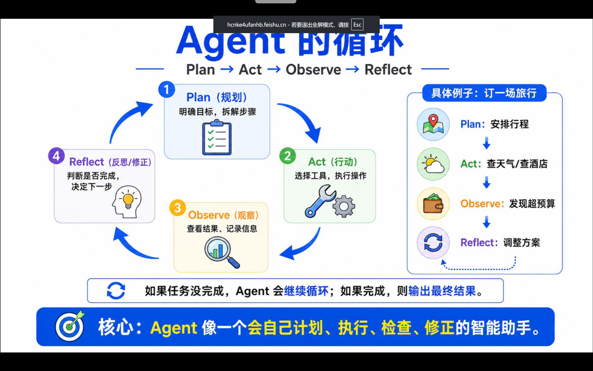
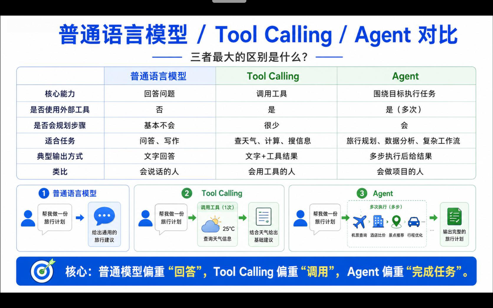

# jotang recruit AI agent learning note

- 你使用了什么 Agent

	codex+deeseek 和workbuddy

- 安装和配置过程

	[DeepSeek V4 Flash 接入 Codex 教程（可识图）_哔哩哔哩_bilibili](https://www.bilibili.com/video/BV13wGT6uEts/?spm_id_from=333.337.search-card.all.click&vd_source=88fa49fbb8dd0249c4ac667b1ad83649)

	跟着这个up主安装的，重点就是拿deepseek密钥，安装cc swicth,配置deepseek,验证接入
	（不好意思，暂时没钱用chatgpt，而且还没跑通订阅流程，之前注册了个号被封了）

	workbuddy 就直接在官网上下的

- 你交给了它什么任务

  让codex帮我完成开发环境的搭建，安装  Miniconda，CUDA，PyTorch，numpy、matplotlib 和 scikit-learn，创建独立的 Python 虚拟环境

  让Codex帮我向github上传文件(自己上传总是很满会遇到网络问题，用codex就很方便)
  让codex帮我改代码，完成项目

  让workbuddy帮我创建了一个依力老师的skiil

  

- Agent 做了哪些修改
修改新增代码

	

- `git diff` 中你看到了什么
哪些文件被改动，哪些代码被删除
	

- 最终结果是否符合你的预期

1. Agent 为什么能够读取文件、修改代码，而普通聊天 AI 通常不能？

	- 模型被放在一个 **Agent Loop（循环）** 里：思考 → 选择工具 → 执行 → 观察结果 → 再思考
	- 它被授予了 **工具**，比如 `read_file`、`write_file`、`run_command`、`search`
	- 这些工具背后是真实的运行环境（本地 shell、容器、IDE、浏览器等），所以能产生真实副作用

	

2. Tool 在 Agent 中起到了什么作用？

	Tool 是 Agent 与外部世界之间的**接口层**

	1. **扩展能力边界**：模型不会真的“读文件”，它只是生成一个结构化调用（如 `read_file(path="a.py")`），由运行时去执行
	2. **把自然语言变成可执行动作**：模型输出 JSON/函数调用，工具层解析并执行
	3. **提供反馈**：执行结果（文件内容、报错、命令输出）会回到模型上下文，供它下一步决策
	4. **约束与安全边界**：工具是白名单机制——能做什么、不能做什么，由工具定义决定，而不是模型想干什么就干什么

3. 为什么项目需要给 Agent 配置一份类似“员工手册”的规则?

	Agent 的行为**高度依赖上下文**

	- **一致性**：让 Agent 遵循项目的代码风格、目录结构、命名规范
	- **减少反复解释**：不用每次对话都重复“我们用什么框架、怎么跑测试”
	- **约束危险行为**：比如“不要直接改 main 分支”“不要删迁移文件”“提交前必须跑 lint”
	- **注入领域知识**：项目特有的约定、坑、历史决策
	- **降低幻觉**：告诉它哪些命令可用、哪些路径重要

4. Agent 为什么可能“忘记”之前说过的内容？Agent的额度怎么样计算？

	1. **上下文窗口有限**：对话太长，早期内容被截断或压缩
	2. **会话隔离**：新开一个 session，之前的上下文不自动带入
	3. **记忆机制缺失**：很多 Agent 没有长期记忆，只有当前上下文
	4. **压缩/摘要丢失细节**：为了省 token，系统会把历史总结，细节被抹掉
	5. **工具结果太大被裁剪**：读了一个大文件后，内容可能被截断
	6. **多 Agent/子任务隔离**：子 Agent 不一定继承主对话的全部上下文

5. 如果一个 Agent 可以随便执行任何终端命令，会有什么风险？

	- **Token 消耗**：输入 + 输出 token，包括系统提示、工具定义、历史对话、工具返回结果。**工具返回的大段文件内容也会算 token**，这是很多人忽略的消耗大头
	- **请求次数**：有些按 API 调用次数或对话轮数限制
	- **Agent 步数/工具调用次数**：复杂任务可能跑几十步，每步都消耗额度
	- **时间窗口**：如每 5 小时、每天、每月的配额
	- **模型分级**：强模型消耗倍率更高，弱模型更低

### 下面是让agent做的介绍图

